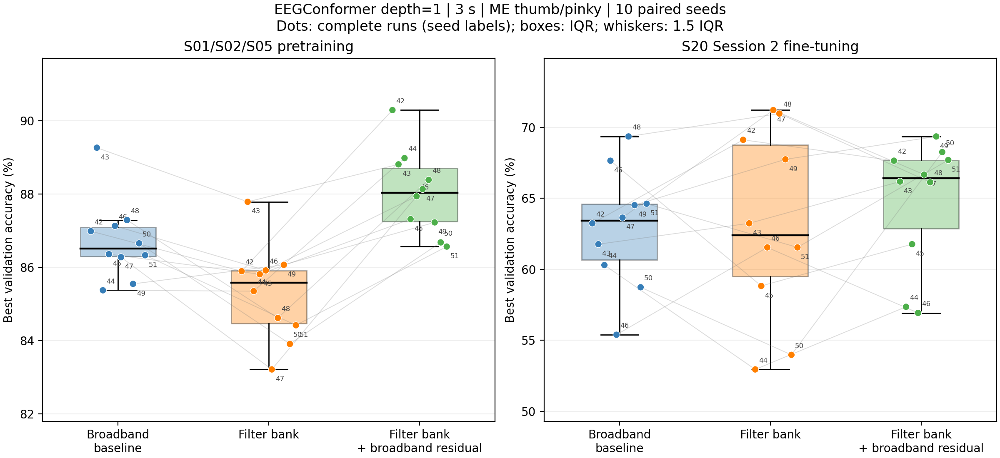
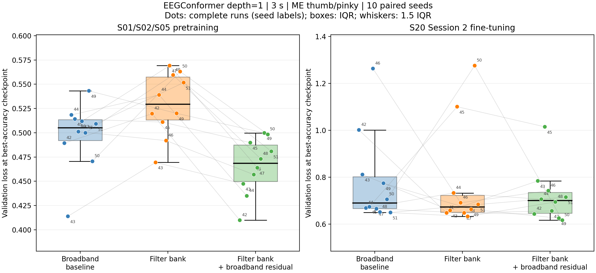
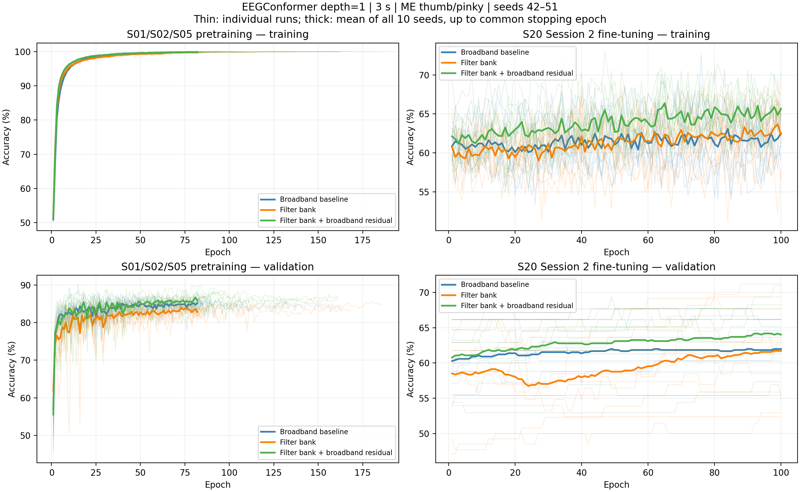
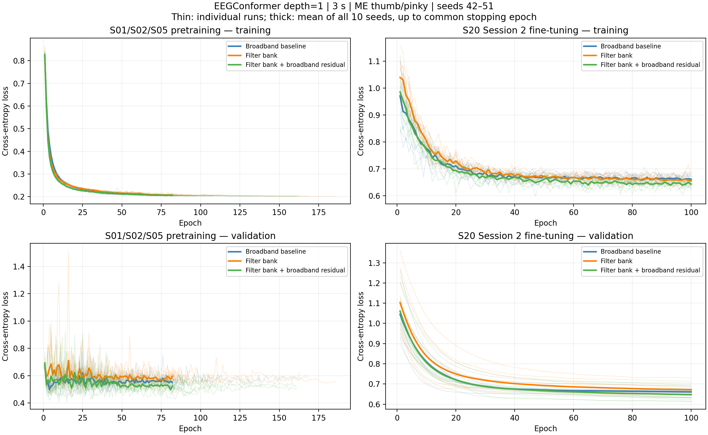

# EEGConformer 十次重复实验

三种配置各完成 10 次预训练＋微调，种子为 42–51；本轮新增 47–51。
seed=42–46 复用前一批已核验实验，每个种子在统计中只计一次。
ME 拇指/小指二分类；depth=1；windowlen=3 s；128 通道。
S01/S02/S05 预训练，S20 Session 2 Base 数据微调。

## 准确率结果

数值为最高验证 accuracy 的均值 ± 样本标准差（百分数，n=10）。
这是随机划分与初始化的重复验证结果，没有独立测试集。

| 配置 | 预训练验证 acc | S20 微调验证 acc | S20 中位数 |
|---|---:|---:|---:|
| Baseline | 86.72 ± 1.09% | 62.92 ± 4.11% | 63.44% |
| 频带 | 85.30 ± 1.30% | 63.11 ± 6.63% | 62.39% |
| 频带＋残差 | 88.03 ± 1.15% | 64.80 ± 4.51% | 66.42% |

## 前后两批对照

每批各 5 次。以下仅用于观察新增运行对汇总结果的影响，最终箱形图包含全部 10 次。

| 批次 | 配置 | 预训练验证 acc（均值 ± SD） | S20 验证 acc（均值 ± SD） |
|---|---|---:|---:|
| 前五次：42–46 | Baseline | 87.02 ± 1.43% | 61.67 ± 4.46% |
| 前五次：42–46 | 频带 | 86.15 ± 0.94% | 61.13 ± 5.93% |
| 前五次：42–46 | 频带＋残差 | 88.67 ± 1.13% | 61.97 ± 4.92% |
| 新增五次：47–51 | Baseline | 86.42 ± 0.63% | 64.17 ± 3.78% |
| 新增五次：47–51 | 频带 | 84.45 ± 1.06% | 65.09 ± 7.34% |
| 新增五次：47–51 | 频带＋残差 | 87.40 ± 0.83% | 67.62 ± 1.28% |

## 每次 S20 微调结果

| Seed | Baseline | 频带 | 频带＋残差 | 验证窗口数 |
|---|---:|---:|---:|---:|
| 42 | 63.24% | 69.12% | 67.65% | 68 |
| 43 | 61.76% | 63.24% | 66.18% | 68 |
| 44 | 60.29% | 52.94% | 57.35% | 68 |
| 45 | 67.65% | 58.82% | 61.76% | 68 |
| 46 | 55.38% | 61.54% | 56.92% | 65 |
| 47 | 63.64% | 71.21% | 66.67% | 66 |
| 48 | 69.35% | 70.97% | 66.13% | 62 |
| 49 | 64.52% | 67.74% | 69.35% | 62 |
| 50 | 58.73% | 53.97% | 68.25% | 63 |
| 51 | 64.62% | 61.54% | 67.69% | 65 |

## 配对差值

以下在同一种子、同一数据划分上相减，单位为百分点。
均值和标准差用于描述这 10 次运行，不代表统计显著性结论。

| 对比 baseline | 平均差值 ± SD | 高于 / 等于 / 低于 baseline |
|---|---:|---:|
| 频带 | +0.19 ± 5.86 | 6 / 0 / 4 |
| 频带＋残差 | +1.88 ± 4.62 | 7 / 0 / 3 |

## 箱形图

每个散点是一组完整实验，数字为随机种子；同种子用细线连接。
箱体为四分位距，黑线为中位数，须按 1.5×IQR 规则绘制。所有原始点均显示。
loss 使用最高 accuracy checkpoint 的验证 loss，不是全程最低 loss；每次最低 loss 另存于 run_metrics.csv/json。

## 逐轮曲线

细线为各次运行，粗线为 10 次均值。均值只画到该阶段所有配置共同完成的轮数，早停后的轮次不补值，也不以剩余运行代替 10 次均值。

## 协议与核验

每种子同时改变初始化和 80/20 trial 划分；同种子下三组 trial 与窗口分配完全一致。
先划分 trial，再按该划分选取窗口，训练与验证 trial 没有交集。
缓存仅存储逐窗口的固定滤波和标准化结果；真实数据上的 24 项对照逐元素一致。
所有 60 个 checkpoint 均已重新加载，在其完整验证集上复算 loss 与 accuracy，并与保存时的历史记录核对。文件 SHA256、源码 SHA256、depth/windowlen、微调初始化 checkpoint 路径及组间训练协议均已核验。
各次结果来自同一批受试者数据；10 个随机种子不等于 10 组独立受试者实验。

每次模型及记录位于 seed_XX/variant/；逐轮训练曲线和 history.json 均保留。
PROTOCOL.md 记录完整设置；run_metrics.csv/json 为每次指标；descriptive_statistics.csv/json 为均值、标准差、中位数、四分位数等。
final_verification.json 包含 60 个 checkpoint 的复算结果和哈希。
本地导出包不包含原始 EEG 数据和大型预处理缓存。
