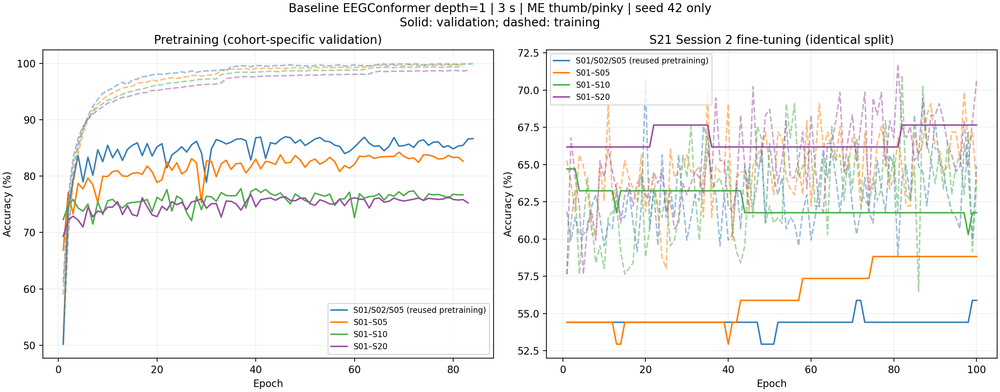
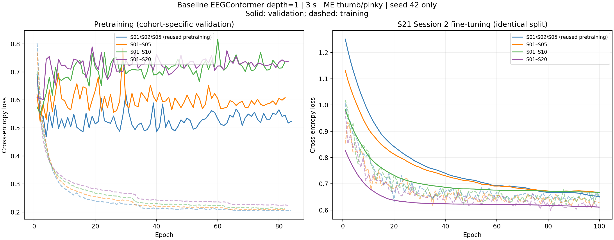
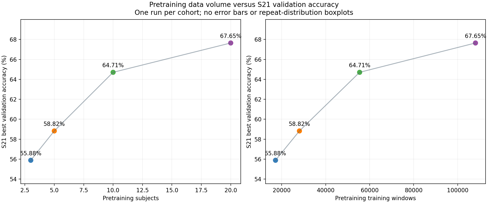

# EEGConformer 预训练数据量与 S21 迁移实验

四组各运行一次（seed=42），仅使用宽带 EEGConformer baseline。新增 S01–S05、S01–S10、S01–S20 三组预训练。
参考组复用原 S01/S02/S05、seed=42 的预训练权重，四组均重新在 S21 Session 2 Base 数据上微调。原 S20 微调结果不参与本次比较。

## 结果

| 预训练被试 | 预训练 trial | 预训练训练窗口 | 预训练最佳验证 acc | S21 最佳验证 acc | S21 对应 loss |
|---|---:|---:|---:|---:|---:|
| S01/S02/S05 (reused pretraining) | 4864 | 17185 | 86.99% | 55.88% | 0.6849 |
| S01–S05 | 8064 | 28056 | 84.24% | 58.82% | 0.6773 |
| S01–S10 | 16104 | 55429 | 77.78% | 64.71% | 0.9824 |
| S01–S20 | 31924 | 108111 | 76.73% | 67.65% | 0.6341 |

## 实验设置

ME 拇指/小指二分类，128 通道，depth=1，3 秒窗口，原始 1024 Hz 降采样为 100 Hz。预训练使用离线 Movement 与在线 Session 1/2 的 Base、Finetune 数据。S21 仅用于目标微调。
按 trial 做 80/20 划分后再分窗。四组 S21 trial 与窗口划分完全相同。预训练各组对自己的合并 trial 列表按 seed=42 划分，因此各组预训练验证集不同。
batch=32，预训练/微调 dropout=.5/.65，Adam 学习率 .0005/.00005，最大 300/100 轮，val_loss 早停 patience=80，降学习率 patience=30、factor=.5，label smoothing=.1。微调相同四个 Dense 层。
checkpoint 取首次达到最高验证 accuracy 的模型，loss 为同一个 checkpoint 对应的验证 loss。所有新增 checkpoint 均重新加载并在完整验证集复算。

## 数据与内存

数据目录：`/Dataset2/dataset_bci_decode_kxy`。逐 MAT 文件读取并做 CAR、分窗、重采样、滤波、标准化，写入每被试 float32 窗口缓存。训练仅按批读取，预取一个 batch，不将全量数据复制到 CPU/GPU Tensor。TensorFlow 显存分配上限 16 GiB，驱动上下文另有开销。
新预处理与旧流程已在真实文件和合成数据上逐元素对照。原 float64 滤波结果转 float32 缓存，与旧 TensorFlow 输入到模型时的 float32 精度一致。
S09 有额外的在线运行，S13 有 22 个离线 ME 文件，S19 Session 2 二分类 Finetune 有 4 个文件。使用所有已校验文件，逐文件 SHA256、实际 trial 和窗口数已保存。
全部 1,924 个文件的事件配对已检查。S09 Session 1 3class_Finetune R07 有一个无对应 Target 的多余 TrialEnd（事件索引 26）。加载器按事件顺序配对，忽略并记录该标记，保留全部 20 个拇指/小指 trial。其他文件没有此异常。详情见 event_pairing_audit.json。
复用的三人参考模型也通过新缓存完整复算了原 4,211 个预训练验证窗口，准确率与旧记录一致，loss 在 1e-4 容差内。
新增组使用每轮完整的 NumPy 随机排列；复用参考组保留原 TensorFlow shuffle 的历史。训练随机顺序并非逐步一致。

## 解读边界

这是单随机种子的验证结果，没有独立测试集。不能据此估计重复实验方差或统计显著性，因此本轮不使用箱形图。
扩大被试范围同时改变数据量和被试构成，且相同 epoch 下优化步数增加。本结果反映这一整体变化，不是严格固定构成或计算预算的数据量因果实验。

