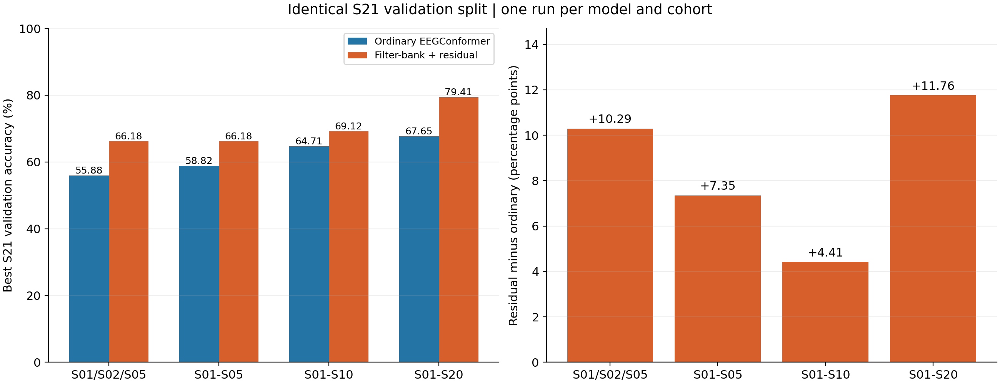
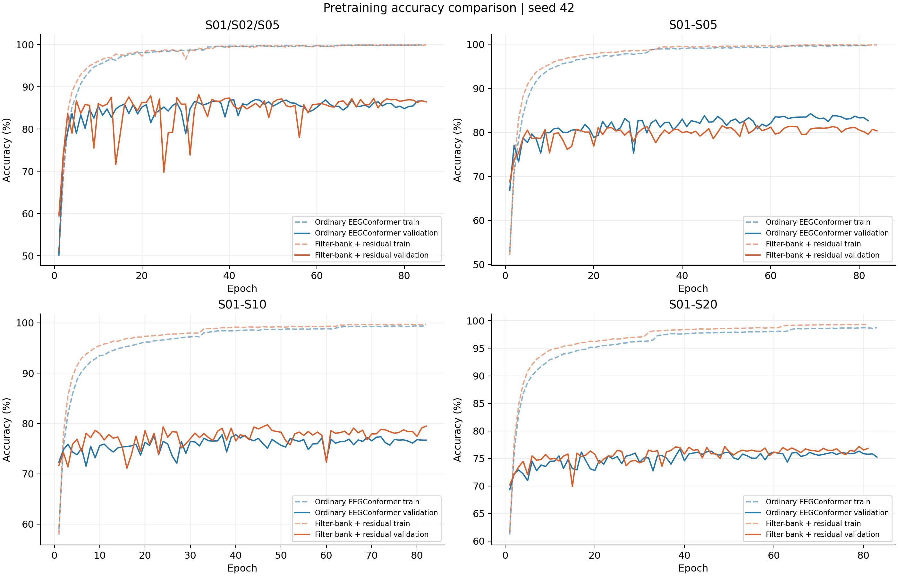
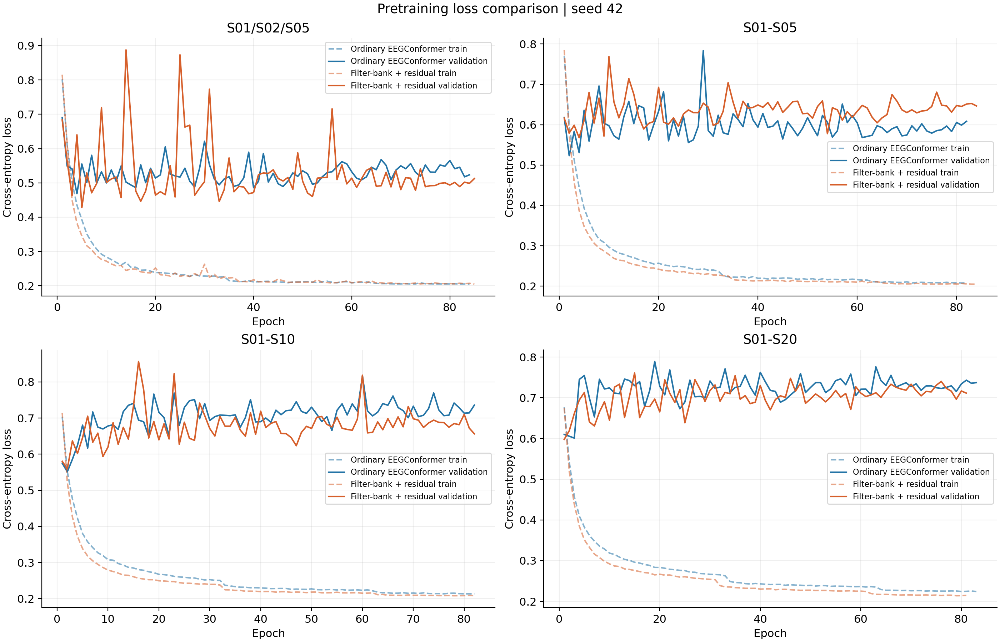
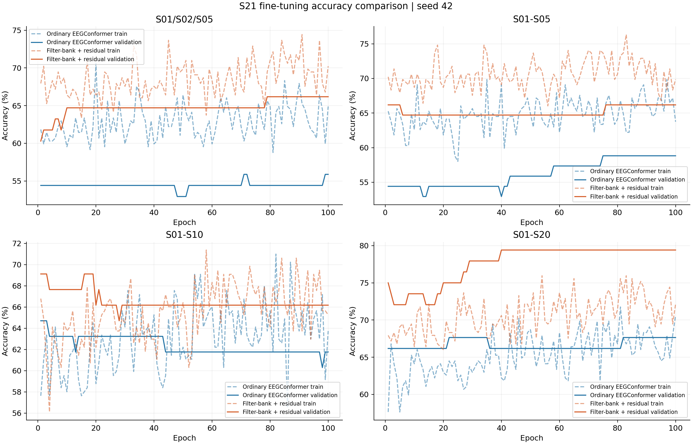
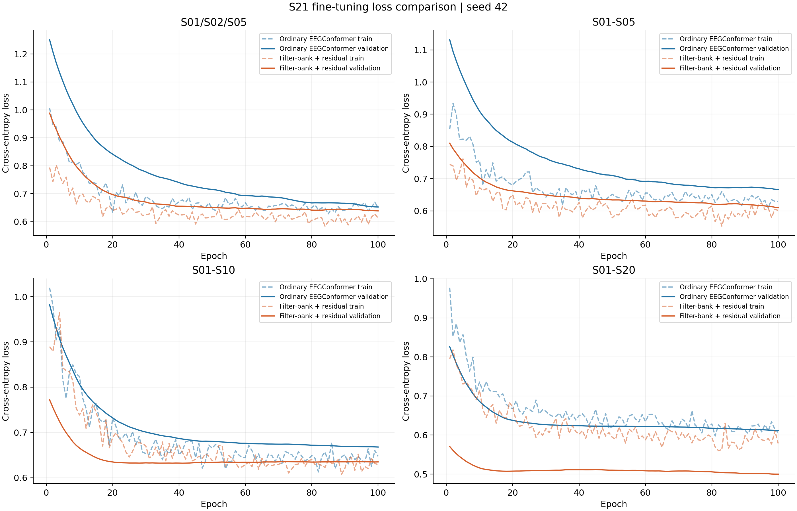

# 频带残差与普通 EEGConformer 数据规模比较

ME 拇指/小指二分类，depth=1，3 秒窗口，seed=42，每组一次。普通模型复用上次结果，频带残差四组全部重新预训练并在 S21 Session 2 Base 微调。

| 预训练组 | 普通 S21 acc | 频带残差 S21 acc | 差值（百分点） | 普通 loss | 频带残差 loss |
|---|---:|---:|---:|---:|---:|
| S01/S02/S05 | 55.88% | 66.18% | +10.29 | 0.6849 | 0.6433 |
| S01-S05 | 58.82% | 66.18% | +7.35 | 0.6773 | 0.8100 |
| S01-S10 | 64.71% | 69.12% | +4.41 | 0.9824 | 0.7722 |
| S01-S20 | 67.65% | 79.41% | +11.76 | 0.6341 | 0.5113 |

## 训练与评估

预训练/微调：最大 300/100 epoch，Adam 0.0005/0.00005，dropout 0.5/0.65，batch=32。val_loss 早停 patience=80，降学习率 patience=30、factor=0.5，label smoothing=0.1。
两种模型在同一被试组中直接共用上一轮保存的 trial 划分，分窗后再次核对索引。S21 为 256/64 个训练/验证 trial，对应 262/68 个有效窗口。选择首次最高验证 acc checkpoint，报告同一 checkpoint 的 loss。
普通模型参数 379,306，频带残差 412,751（增加约 8.82%）。微调共同的最后四个 Dense 层，频带残差还训练 4 个频带 logits 与 1 个门控参数，其余前端冻结。

## 前端与数据加载

数据位于 `/Dataset2/dataset_bci_decode_kxy/data`。输入 128×300×5：四个独立标准化子带 [4,8]/[8,13]/[13,30]/[30,40] Hz，加上 [4,40] Hz 宽带。子带使用独立时间卷积与 Depthwise 空间卷积，softmax 权重融合后加上 sigmoid 门控宽带分支。
逐 MAT 文件预处理，按被试保存 float32 缓存。内存映射每次读取 32 个窗口，预取 1 个 batch，保留尾 batch。TensorFlow 分配上限为每进程 16 GiB，CUDA 上下文另有开销。
20 人缓存 96.43 GiB。核对了 1924 个源文件 SHA256 与窗口索引，数据内容与上一轮一致。S09 的孤立 TrialEnd 按已有规则忽略并记录。

## 解释边界

这是单次运行的最佳验证结果，没有独立测试集。用验证集选择 checkpoint 会带来选择偏差，不能从本轮推断统计显著性、跨随机种子稳定性或独立测试性能。
比较的是完整前端插件配置。除了频带划分，还改变了空间卷积、特征归一化、参数量及微调可训练参数，因此不能把差值单独归因为频带归纳偏置。
频带 softmax 和残差系数是模型级融合参数。标准化去除了绝对频带功率，它们不能直接解释为手指重要性或神经生理贡献。
扩大被试范围同时改变数据量、被试构成与每轮优化步数。普通三人参考组复用了旧 TensorFlow shuffle 历史，其余新训练使用 NumPy 全排列，因此三人组随机训练顺序也存在差异。

